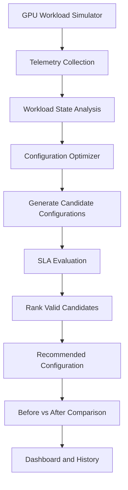

# GPUPilot 🚀
### AI-Powered GPU Sustainability & Workload Optimization Controller

**GPUPilot** is a vendor-neutral GPU sustainability controller designed to optimize AI workloads by balancing energy consumption, thermal conditions, performance, and Service Level Agreement (SLA) requirements.

As AI workloads grow, GPU infrastructure faces increasing power consumption, heat generation, and resource utilization challenges. GPUPilot evaluates workload conditions and recommends optimized serving configurations to improve infrastructure efficiency without compromising critical performance requirements.

> **Optimize AI workloads. Reduce unnecessary GPU overhead. Keep performance within SLA.**

---

## 🎯 Problem Statement

AI inference workloads are dynamic. Request rates, latency, GPU utilization, memory consumption, and thermal conditions can change rapidly.

Static GPU configurations may lead to:
- ⚡ Unnecessary power consumption.
- 🌡️ Increased GPU temperature and thermal stress.
- 📉 Inefficient GPU resource utilization.
- ⏱️ SLA violations during workload spikes.
- 💸 Higher operational costs for shared GPU infrastructure.

Traditional fixed configurations cannot always adapt efficiently to changing workload demands.

## 💡 Our Solution

GPUPilot introduces an intelligent optimization layer that monitors workload telemetry, evaluates alternative configurations, checks SLA constraints, and recommends a suitable configuration for the current workload.

The controller considers parameters such as:

- GPU allocation
- Batch size
- Numerical precision, such as FP16 and INT8
- Number of replicas
- Request concurrency

Its objective is to find a practical balance between resource efficiency, power consumption, thermal conditions, latency, and throughput.

## ✨ Key Features

### 📊 1. Live GPU Monitoring Dashboard
Monitor simulated GPU infrastructure metrics, including:
- GPU utilization
- GPU power consumption
- GPU temperature
- GPU memory usage
- Request rate
- Inference latency
- Throughput
- SLA status

### 🧠 2. Intelligent Configuration Optimization
Evaluate alternative serving configurations and identify candidates that better satisfy workload and efficiency objectives.

### 🛡️ 3. SLA-Aware Decision Making
Evaluate candidate configurations against latency and throughput requirements to avoid recommending configurations that violate critical service constraints.

### 📈 4. Before-and-After Comparison
Compare the current configuration with an optimized recommendation to understand the impact on resource utilization, power, temperature, latency, and throughput.

### 🔄 5. Dynamic Workload Simulation
Simulate workload changes and traffic spikes to demonstrate how the controller evaluates configurations under changing operating conditions.

### 📜 6. Telemetry History
Access recorded telemetry history and export historical data for further analysis.

### 🌱 7. Sustainability-Focused Optimization
Use power and thermal telemetry as optimization signals to help reduce unnecessary resource consumption while maintaining acceptable service performance.

---

## 🏗️ System Architecture



### How It Works

1. **Telemetry collection:** Gather workload metrics from the GPU simulator.
2. **Workload analysis:** Identify current resource usage and workload conditions.
3. **Candidate generation:** Explore alternative configurations using parameters such as batch size, precision, and GPU allocation.
4. **SLA evaluation:** Assess candidates against performance constraints.
5. **Optimization:** Select a suitable candidate based on the optimization objective and feasibility checks.
6. **Visualization:** Display telemetry, recommendations, and comparison metrics on the dashboard.

---

## 🛠️ Technology Stack

| Component | Technology |
|---|---|
| Backend API | Python, FastAPI |
| Optimization Engine | Python-based configuration evaluation |
| API Server | Uvicorn |
| Dashboard | React.js |
| Charts and Visualization | Chart.js / Recharts, depending on the frontend implementation |
| Telemetry | GPU workload simulator |
| API Documentation | OpenAPI, Swagger UI |
| Version Control | Git and GitHub |

### Planned Production Integrations

- NVIDIA Management Library (NVML) and NVIDIA DCGM for real GPU telemetry.
- vLLM or NVIDIA Triton for AI inference serving.
- Docker and Kubernetes for deployment and orchestration.
- PostgreSQL, Prometheus, and Grafana for persistent storage and monitoring.

These production integrations are distinct from the simulator-based hackathon implementation.

---

## 🚀 Getting Started

### Prerequisites

- Python 3.10 or a compatible version supported by the project dependencies.
- Node.js and npm for the frontend.
- Git.

### 1. Clone the Repository

```bash
git clone https://github.com/MilanSharma-root/GPUPilot-v2.git
cd GPUPilot-v2
```

### 2. Set Up the Backend

Open a terminal in the backend directory containing `requirements.txt` and `main.py`.

Create a virtual environment:

```bash
python -m venv venv
```

Activate it on Windows:

```powershell
.\venv\Scripts\Activate.ps1
```

Install the dependencies:

```bash
pip install -r requirements.txt
```

Start the FastAPI server:

```bash
python -m uvicorn main:app --reload --port 8000
```

### 3. Access the Backend

Once the server is running, open:

- **API documentation:** http://127.0.0.1:8000/docs
- **Alternative documentation:** http://127.0.0.1:8000/redoc
- **Health check:** http://127.0.0.1:8000/api/health
- **Telemetry:** http://127.0.0.1:8000/api/telemetry

### 4. Run the Frontend

Open a separate terminal in the actual frontend directory containing `package.json`.

```bash
npm install
npm run dev
```

Open the local URL printed by Vite or your configured frontend development server.

**Note:** The commands assume the repository contains the expected backend and frontend files. If your folder structure differs, adjust the working directories accordingly.

---

## 🔌 API Endpoints

The backend exposes endpoints for telemetry, configuration management, optimization, simulation, and historical data.

| Endpoint | Purpose |
|---|---|
| `GET /api/health` | Check backend availability |
| `GET /api/telemetry` | Retrieve current simulated telemetry |
| `GET /api/history` | Retrieve telemetry history |
| `GET /api/history/export` | Export historical data |
| `/api/configuration` | Read or manage configuration |
| `/api/configuration/evaluate` | Evaluate a configuration |
| `/api/sla` | Access SLA settings or status |
| `/api/optimize` | Request an optimization recommendation |
| `/api/demo/comparison` | Retrieve demo comparison data |
| `/api/simulation/start` | Start the simulation |
| `/api/simulation/stop` | Stop the simulation |
| `/api/simulation/reset` | Reset the simulation |
| `/api/simulation/spike` | Trigger a workload spike |
| `/api/simulation/step` | Advance a simulation step |

Refer to `/docs` for the exact HTTP methods, request bodies, and response schemas.

---

## 📉 Example Optimization Workflow

Suppose a simulated AI inference workload experiences increased traffic and power consumption.

GPUPilot can:

1. Inspect the current GPU telemetry.
2. Generate alternative serving configurations.
3. Evaluate candidates against SLA requirements.
4. Recommend a feasible configuration.
5. Present a comparison of the original and recommended operating conditions.

For example, switching from FP16 to INT8 may reduce resource requirements for a compatible workload. However, actual power savings, latency, throughput, and output quality depend on the model, hardware, workload, and implementation. These benefits must be measured rather than assumed.

---

## 🌍 Why GPUPilot?

- **Vendor-neutral direction:** Designed around workload and infrastructure optimization rather than a single GPU vendor's management interface.
- **SLA-aware optimization:** Considers service performance requirements alongside resource efficiency.
- **Adaptive approach:** Evaluates configuration changes in response to workload conditions.
- **Sustainability focus:** Includes power and thermal metrics in the decision process.
- **Extensible architecture:** Provides a foundation for integration with real GPU monitoring and AI-serving systems.

---

## ⚠️ Current Implementation Status

The current hackathon demonstration uses simulated telemetry to demonstrate the optimization workflow.

| Capability | Status |
|---|---|
| FastAPI backend | Implemented |
| GPU telemetry simulation | Implemented |
| Configuration evaluation and optimization | Implemented in the simulator workflow |
| SLA-aware candidate evaluation | Implemented in the simulator workflow |
| Telemetry history and export endpoints | Available in the backend |
| Real NVIDIA GPU telemetry | Future integration |
| Production AI-serving integration | Future integration |
| Kubernetes-based production orchestration | Future integration |

The simulator demonstrates the control logic and user experience; it does not independently establish real-world GPU energy savings or production performance.

---

## 🔮 Future Roadmap

- Integrate NVML/DCGM for real-time GPU monitoring.
- Connect to vLLM or NVIDIA Triton for inference-serving metrics and configuration changes.
- Implement a closed-loop control workflow with safeguards and rollback.
- Add workload forecasting and predictive optimization.
- Introduce multi-GPU and multi-workload scheduling.
- Measure energy efficiency per request or token using real telemetry.
- Extend the system with infrastructure-aware energy and cost intelligence.
- Support containerized deployment and Kubernetes orchestration.

---

## 👥 Team

**Project:** GPUPilot  
**Domain:** AI Infrastructure, GPU Optimization, and Sustainability

---

## 📄 License

Choose and add an appropriate open-source license before distributing the project publicly.

---

**GPUPilot — Making AI infrastructure more efficient, adaptive, and sustainable.**
